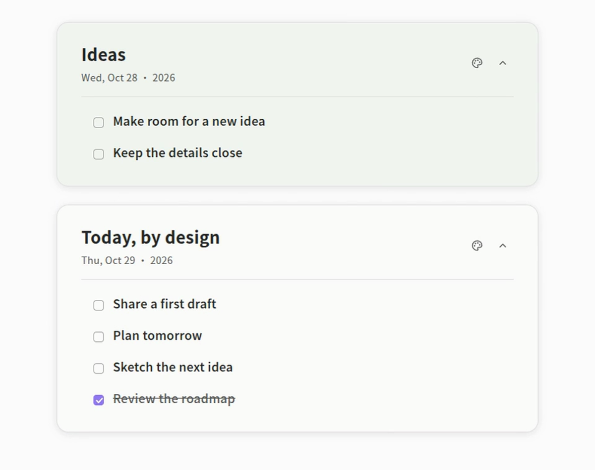
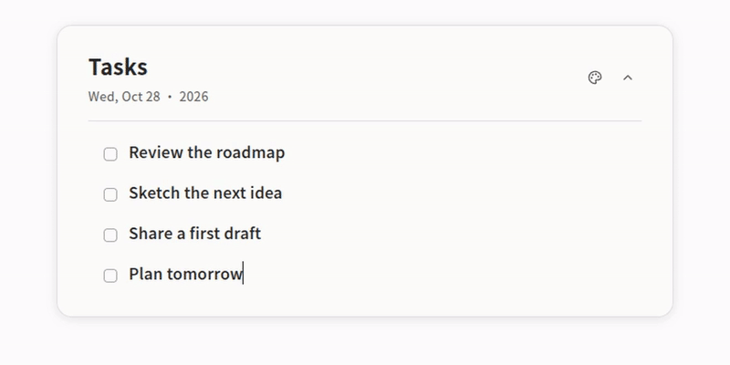
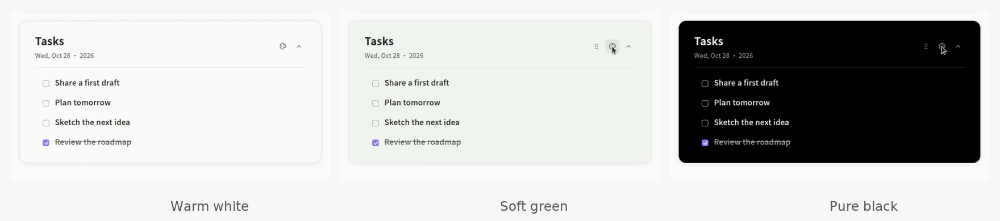

<div align="center">

# Nor Cards

**给 Obsidian 笔记，一点卡片的秩序。**

在笔记里直接书写、勾选和拖动，让任务与想法自然留在原处。

[观看 58 秒演示](assets/demo.mp4) · [安装使用](#安装) · [反馈问题](https://github.com/norinyan/nor-cards/issues)

</div>

[](assets/demo.mp4)

## 写下来，然后继续

- **自然编辑**：点进卡片直接写，Enter 继续下一项，没有编辑、保存表单。
- **轻松整理**：勾选完成项，自动移至卡片底部；拖动任务调整优先级，也能移动整张卡片。
- **自己的节奏**：修改标题、选择日期、折叠展开，用米白、浅绿或纯黑区分内容。
- **留在笔记里**：内容保存在当前 Markdown 笔记，不创建统一任务文件；停用插件后仍可读取。

## 看看实际交互



[▶ 观看完整演示 · 58 秒 · 1080p / 60fps](https://github.com/norinyan/nor-cards/raw/refs/heads/main/assets/demo.mp4)

演示来自真实 Obsidian 操作，包含插入、编辑、任务完成、任务与整卡拖动、换色、日期选择、标题修改和折叠展开。

## 三种安静的配色



点击右上角调色板，依次切换米白 → 浅绿 → 纯黑，无需打开菜单。每张卡片分别保存自己的标题、配色、选定日期和折叠状态。

## 安装

要求 **Obsidian 1.5.0+**。当前版本 **2.5.0**，已在 Linux 桌面端 Obsidian 1.14.5 使用；移动端尚未实机验证。

1. [下载项目 ZIP](https://github.com/norinyan/nor-cards/archive/refs/heads/main.zip) 并解压，找到 [`dist/nor-cards/`](dist/nor-cards)。直接使用预构建文件，无需安装 Node.js 或编译。
2. 将整个 `nor-cards` 文件夹复制到你的知识库 `.obsidian/plugins/` 中，确认以下三个文件直接位于该目录：

   ```text
   .obsidian/plugins/nor-cards/
   ├── main.js
   ├── manifest.json
   └── styles.css
   ```

3. 重新加载 Obsidian，在「设置 → 第三方插件」启用 **Nor Cards**。
4. 建议先在独立知识库体验，再用于日常笔记。

## 快速开始

切换到 **实时预览**，打开命令面板，运行 **Nor Cards: Insert Nor Card**。也可以在「设置 → 快捷键」中为 **Insert Nor Card** 绑定按键。

| 想做什么 | 怎么操作 |
| --- | --- |
| 写任务 | 点击正文输入，Enter 新增下一项；空任务再次 Enter 退出列表 |
| 改标题 | 点击 `Tasks` 直接修改，Enter 或失焦保存，Esc 取消 |
| 完成任务 | 勾选后移至卡片底部；取消勾选回到未完成区域末尾 |
| 排任务 | 悬停任务行，从右侧手柄拖动；限同一卡片、连续列表与相同完成状态 |
| 移动卡片 | 悬停顶部栏，从右侧手柄拖到当前笔记正文块之间的空白处 |
| 选日期 | 点击日期打开月历；未手动选择时跟随当天，选择后固定 |
| 收起内容 | 点击右上角折叠按钮，再次点击展开 |

正文可以保留段落、小标题、链接、加粗及其他 Markdown；目前不承诺所有语法完整所见即所得。**阅读视图**用于查看和勾选，直接编辑及拖动请使用实时预览。拖动时按 Esc 可取消。

## 你的内容，仍然是 Markdown

卡片直接保存在所在笔记中，使用原生 Callout 和 Markdown：

```markdown
> [!nor-card|white-standard-example-id]+ Nor Card
> - [ ] 记下一个想法
> - [x] 完成一件小事
```

一般无需手动编辑标记；请使用插入命令创建新卡片，避免复制出相同 ID。插件停用或卸载后，正文仍可读取，交互样式随之移除。

- 没有后端、数据库、网络请求或第三方 Obsidian 插件依赖。
- 日期只属于卡片，不筛选任务，也不记录任务的创建或完成日期。
- 笔记内容及卡片配置可由 Obsidian 原生同步机制同步，真实多设备 Sync 尚未验证；跨设备离线冲突仍由同步工具处理。
- 同一卡片遇到外部修改冲突时会停止覆盖并保留本地草稿。请复制需要保留的草稿，再重新打开笔记核对版本。
- 整卡拖动仅限当前笔记，嵌套任务随父项移动，不单独排序。

<details>
<summary>开发与构建</summary>

需要 Node.js 22+ 和 npm。在项目根目录执行：

```bash
npm ci
npm run package
```

`npm run dev` 监听源码，`npm run build` 执行 TypeScript 检查和生产构建，`npm run package` 更新 `dist/nor-cards/` 三个安装文件。构建会在根目录生成临时 `main.js`，它不提交到 Git；分发时使用 `dist/nor-cards/`。

源码位于 `src/`，样式集中在 `styles.css`。此仓库仅保留当前插件、构建必需文件、安装包及展示素材。

</details>

## 许可与致谢

插件代码采用 [MIT License](LICENSE)。界面中的 Obsidian 名称与标识归原权利人所有。

展示视频、图片及动图由真实插件操作录制，媒体采用 [CC BY 4.0](https://creativecommons.org/licenses/by/4.0/)，署名 Norin / Nor Cards；其中原创 BGM 和音效为 CC0。本地 Piper 配音的模型及数据许可记录见 [Product Showcase](https://github.com/norinyan/product-showcase/blob/main/examples/nor-cards/RIGHTS.md)，未打包任何字体或模型。

视频制作流程：[Product Showcase](https://github.com/norinyan/product-showcase)。欢迎通过 [Issues](https://github.com/norinyan/nor-cards/issues) 反馈使用问题。
